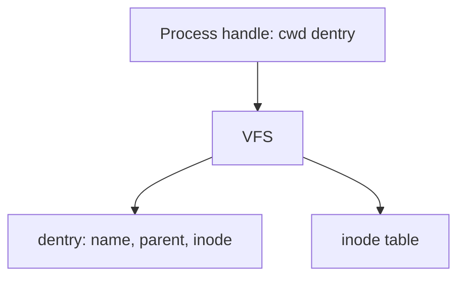

# in-memory-fs

Simplified Unix-like filesystem that lives entirely in memory. No disk.

One filesystem, many shells. Directories are inodes with a name map;
hardlinks are extra names on the same inode; each `connect` keeps its own
cwd.

## Status

**In progress:** [Prompt example](docs/stories/prompt-example.md) on
`feature/prompt-example`. Next: [Release 1.0](docs/stories/release.md)
(`release/1.0`) after this story merges to `develop`.

| Done                                      | In progress        | Next    |
| ----------------------------------------- | ------------------ | ------- |
| files, errno, links, clients, rename/find | prompt walkthrough | release |

Design: [docs/plan.md](docs/plan.md). Assignment: [docs/task.md](docs/task.md).
Board: [docs/status.md](docs/status.md).
Stories: [docs/stories/](docs/stories/README.md).



## Usage

```ts
import { connect, createFileSystem } from 'in-memory-fs'

const fs = createFileSystem()
const sh = connect(fs)

sh.mkdir('school').chdir('school')
sh.getcwd() // '/school'

sh.creat('notes').writeFile('notes', 'hi')
sh.readFile('notes') // 'hi'

const other = connect(fs)
other.readdir('/') // ['school']
other.getcwd() // '/'
```

Mutators return the same shell so they chain. Queries return a value. A
thrown `FsError` stops the chain; `error.code` is the errno string
(`ENOENT`, `EEXIST`, `ENOTDIR`, `EISDIR`, `ENOTEMPTY`, `EINVAL`, `ELOOP`,
`EPERM`).

**Mutators:** `chdir`, `mkdir`, `rmdir`, `unlink`, `rename`, `creat`,
`link`, `symlink`, `writeFile`.

**Queries:** `getcwd`, `readdir`, `readFile`, `readlink`, `lstat`, `stat`,
`find`.

Many shells can share one filesystem. That is 500 clients on one VFS, not
500 OS threads.

## Setup

```bash
npm install
```

## Commands

```bash
npm test
npm run test:watch
npm run lint
npm run typecheck
npm run build
npm run demo
```

`npm test` prints every case and an Istanbul coverage table. Coverage must
stay at or above 90% on `src/` (`demo.ts` is excluded). ESLint treats high
cyclomatic and cognitive complexity as errors.

`npm run demo` builds, then prints the assignment's school/homework
walkthrough.
