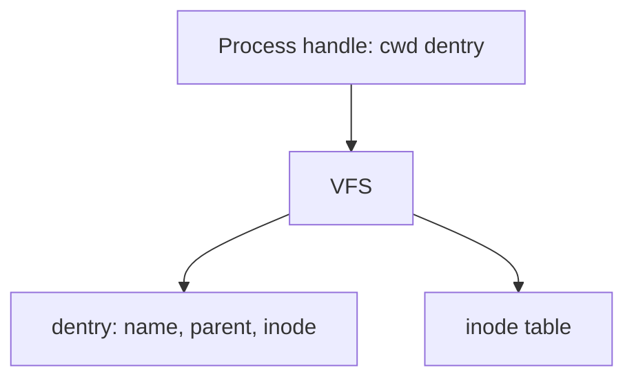

# in-memory-fs

Simplified Unix-like filesystem that lives entirely in memory. No disk.

## Status

**On `feature/file-contents`.** `creat` / `writeFile` / `readFile` are in progress.

| Done            | In progress                      | Next                       |
| --------------- | -------------------------------- | -------------------------- |
| `getcwd` is `/` | `creat`, `writeFile`, `readFile` | `rename`, `unlink`, `find` |

Design: [docs/plan.md](docs/plan.md). Assignment: [docs/task.md](docs/task.md). Board: [docs/status.md](docs/status.md).



## Setup

```bash
npm install
```

## Commands

```bash
npm test
npm run test:watch
npm run coverage
npm run lint
npm run typecheck
npm run build
```

Coverage must stay at or above 90% on `src/` once implementation exists. ESLint treats high cyclomatic and cognitive complexity as errors.
