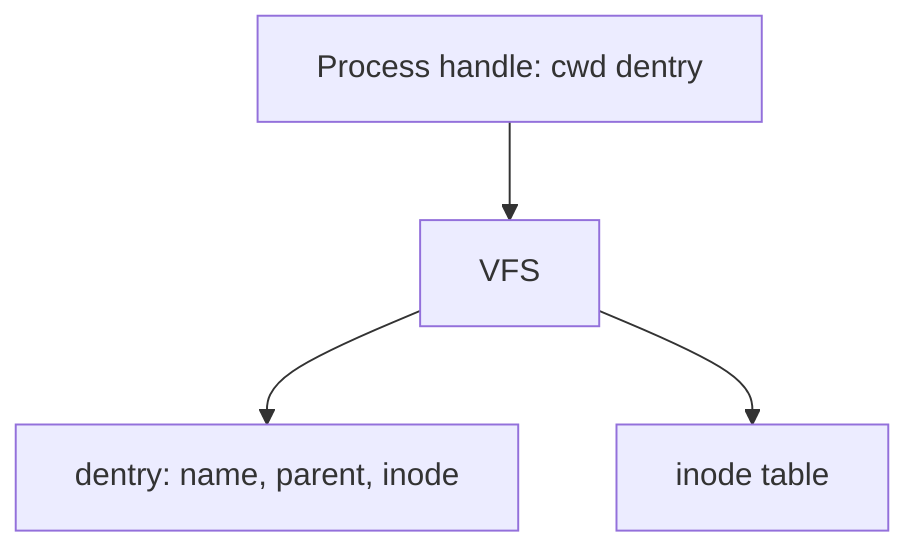

# in-memory-fs

Simplified Unix-like filesystem that lives entirely in memory. No disk.

## Status

**Harness on `develop`.** Tooling is going in first. Shell commands (`mkdir`, `chdir`, …) are not implemented yet.

| Done            | In progress                         | Next                           |
| --------------- | ----------------------------------- | ------------------------------ |
| Plan in `docs/` | Git Flow + lint/test/coverage setup | `feature/navigate-directories` |

Design: [docs/plan.md](docs/plan.md). Assignment: [docs/task.md](docs/task.md). Board: [docs/status.md](docs/status.md).



## Setup

```bash
npm install
```

## Commands

```bash
npm test
npm run test:watch
npm run coverage
npm run lint
npm run typecheck
npm run build
```

Coverage must stay at or above 90% on `src/` once implementation exists. ESLint treats high cyclomatic and cognitive complexity as errors.
