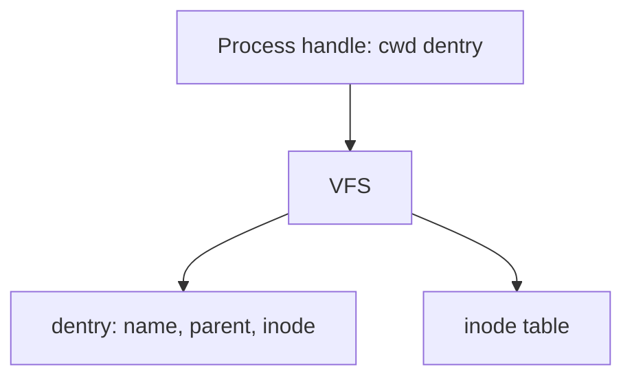

# in-memory-fs

Simplified Unix-like filesystem that lives entirely in memory. No disk.

## Status

**Core stories are on `develop`.** Next: [Prompt example](docs/stories/prompt-example.md) on `release/1.0`.

| Done                                      | In progress | Next               |
| ----------------------------------------- | ----------- | ------------------ |
| files, errno, links, clients, rename/find | —           | prompt walkthrough |

Design: [docs/plan.md](docs/plan.md). Assignment: [docs/task.md](docs/task.md). Board: [docs/status.md](docs/status.md). Stories: [docs/stories/](docs/stories/README.md).



## Setup

```bash
npm install
```

## Commands

```bash
npm test
npm run test:watch
npm run lint
npm run typecheck
npm run build
```

`npm test` prints every case and an Istanbul coverage table. Coverage must stay at or above 90% on `src/`. ESLint treats high cyclomatic and cognitive complexity as errors.
