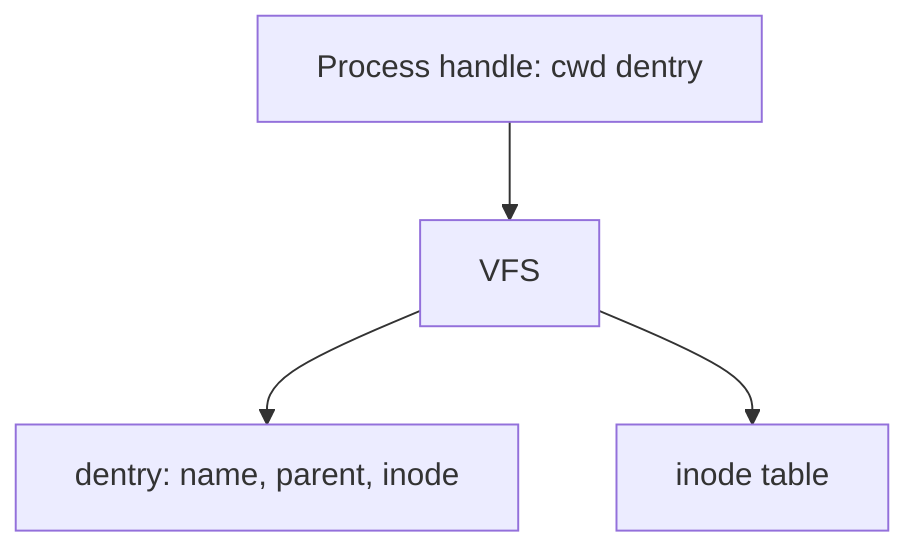

# in-memory-fs

Simplified Unix-like filesystem that lives entirely in memory. No disk.

## Status

**Hardlinks are on `develop`.** Next story: [Multi-client](docs/stories/multi-client.md).

| Done                | In progress | Next                     |
| ------------------- | ----------- | ------------------------ |
| files, errno, links | —           | 500 clients, then `find` |

Design: [docs/plan.md](docs/plan.md). Assignment: [docs/task.md](docs/task.md). Board: [docs/status.md](docs/status.md). Stories: [docs/stories/](docs/stories/README.md).



## Setup

```bash
npm install
```

## Commands

```bash
npm test
npm run test:watch
npm run coverage
npm run lint
npm run typecheck
npm run build
```

Coverage must stay at or above 90% on `src/` once implementation exists. ESLint treats high cyclomatic and cognitive complexity as errors.
