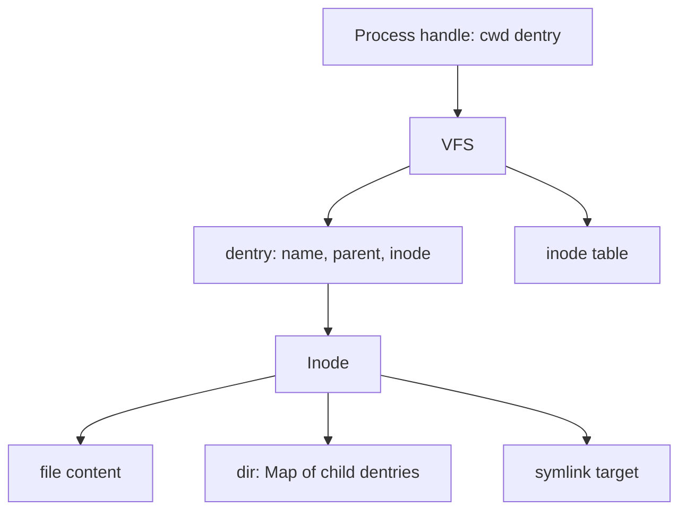

# In-memory filesystem (Unix-like VFS)

Living plan. Update this file whenever the approach changes.

**Status:** quality harness is on `develop` (uncommitted until you say so). No filesystem behavior yet.

Source of requirements: [task.md](task.md).

## Paradigm: fluent shell API, mutable VFS inside

Public interface: `createFileSystem()` plus `connect(fs)` returning a **shell handle** with methods. **Mutating commands return `sh` so callers can chain.** Queries return data (chain ends). Internals are plain data (`Inode`, `Dentry`, shared filesystem state) mutated in place so 500 clients can share one table. Not copy-on-write.

```ts
const fs = createFileSystem();
const sh = connect(fs);

sh.mkdir('school').chdir('school').getcwd(); // "/school"
sh.chdir('school').writeFile('notes', 'hi');
```

- Return **`sh`**: `mkdir`, `chdir`, `rmdir`, `creat`, `writeFile`, `rename`, `unlink`, `link`, `symlink`.
- Return **a value**: `getcwd`, `readdir`, `readFile`, `find`, `readlink` (and `stat` / `lstat` if present).
- Sync: return or `throw` errno. A throw stops the chain.
- Path split/join stay tiny functions in `src/path.ts`. Implementation may be a small class with `return this` or a factory of closures that return the same handle.

## Stack and quality gates

- ESM, `strict: true`, modern Node. **Zero runtime dependencies.**
- **Vitest** tests in BDD style (`describe` / `it`). **Istanbul** via `@vitest/coverage-istanbul`. Fail below **90%** statements/branches/functions/lines on `src/` (exclude `demo.ts`).
- **ESLint 9** type-checked + **Prettier**. **Complexity is an error** on `src/` (tests exempt). **Husky**: pre-commit lint-staged; pre-push `tsc`, ESLint, tests.

Complexity limits (ESLint errors):

- `complexity`: 10
- `sonarjs/cognitive-complexity`: 15
- `max-depth`: 3
- `max-params`: 4
- `max-lines-per-function`: 50
- `max-statements`: 20
- `max-nested-callbacks`: 3

No `eslint-disable` for these on production code. If path walk or `find` trips a rule, extract a helper.

**Why not Promises?** No disk. One Node thread; a sync call is already atomic. No mutex.

**devDependencies only:** `typescript`, `@types/node`, `vitest`, `@vitest/coverage-istanbul`, `eslint`, `@eslint/js`, `typescript-eslint`, `globals`, `eslint-plugin-sonarjs`, `prettier`, `eslint-config-prettier`, `husky`, `lint-staged`.

## Development method: BDD-style tests (Vitest only)

Outside-in. Write the behavior as a Vitest `describe` / `it` first, implement until it passes, then refactor.

- One user story = one test file under `test/` = one Git Flow feature branch.
- Tests call only the public shell methods.
- Do not add `link` to make `mkdir` pass.
- After green: if ESLint complexity fails, extract functions before the next scenario.

Stories:

1. `feature/navigate-directories` — cwd `/`, mkdir, chdir, readdir, rmdir
2. `feature/file-contents` — creat, write, read, rename, unlink, find
3. `feature/error-and-paths` — errno and Unix path cases
4. `feature/symlinks`
5. `feature/hardlinks` — files and directories; cycle rejected
6. `feature/multi-client` — 500 processes

```ts
describe('navigate directories', () => {
  it('starts a new process at /', () => {
    const sh = connect(createFileSystem());
    expect(sh.getcwd()).toBe('/');
  });

  it('mkdir then chdir updates getcwd', () => {
    const sh = connect(createFileSystem());
    expect(sh.mkdir('school').chdir('school').getcwd()).toBe('/school');
  });
});
```

## Git Flow

`master` is production. `develop` is integration. `feature/<story>` from `develop`. `release/*` for polish. `hotfix/*` if `master` is broken.

Atomic commits. Human messages, imperative, short. No `feat:`, no “enhance robustness”.

Good: `Make getcwd return / for a new process`

Bad: `feat(fs): implement mkdir syscall semantics`

## Living docs

After each story merge: this file, [status.md](status.md), [README.md](../README.md), [stories/](stories/). Keep [task.md](task.md) as the original prompt.

All diagrams are Mermaid.

## VFS design



- **Inode**: `S_IFREG` / `S_IFDIR` / `S_IFLNK`, `nlink` = number of dentries.
- **Dentry**: a name in a parent pointing at an inode. Hardlinks are extra dentries. Children live on the inode; `..` follows the dentry you `chdir`’d through.
- **Process**: `connect(fs)` with its own cwd. `getcwd` walks parents. Root’s `..` is itself.
- Path walk: `/`, `.`, `..`, symlink follow max 40 (`ELOOP`). Do not store `.`/`..` in the child Map. Default `readdir` hides names starting with `.`.

## Command semantics

- `mkdir`: parents must exist, no `mkdir -p`.
- `chdir`: must be a directory; follow symlinks. `..` at `/` stays `/`.
- `rmdir`: empty directory; `ENOTEMPTY`.
- `creat`: empty file; `EEXIST` if the name exists.
- `writeFile` truncates; `readFile` like `cat`; `EISDIR` on a directory.
- `unlink`: non-directories only (`EISDIR`).
- `rename`: files and dirs, including across directories; `EEXIST` if the target exists.
- `find`: exact basename under cwd; do not descend symlink dirs.

Errno: `ENOENT`, `EEXIST`, `ENOTDIR`, `EISDIR`, `ENOTEMPTY`, `EINVAL`, `ELOOP`, `EPERM`.

## Extensions

**500+ clients:** many `connect(fs)` handles, one filesystem. Unique names; a 501st `readdir` sees all; cwds stay isolated. No mutex. Not 500 OS threads.

**Symlinks:** `readlink` does not follow. `chdir` / `readFile` / `writeFile` follow.

**Hardlinks:** `link` adds a dentry. Directory hardlinks allowed. Refuse linking a dir under itself. `find` uses a visited-inode set.

## Out of scope

Permissions, mounts, devices, `mkdir -p`, rename-overwrite, file descriptors, Promises/mutex.
